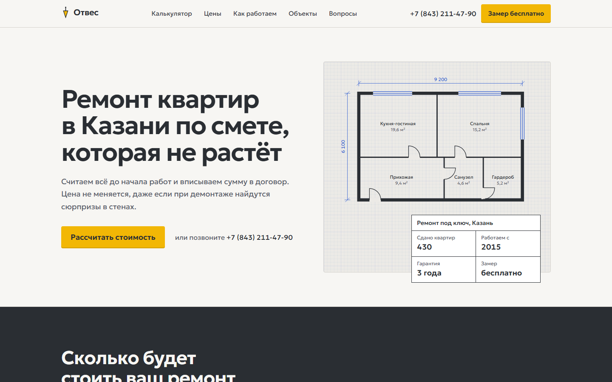
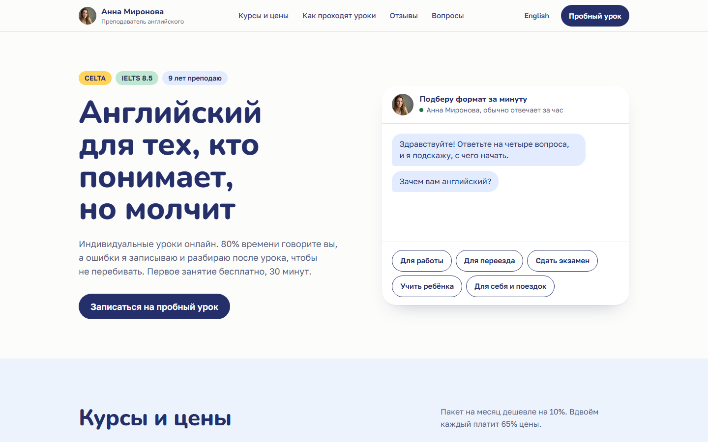
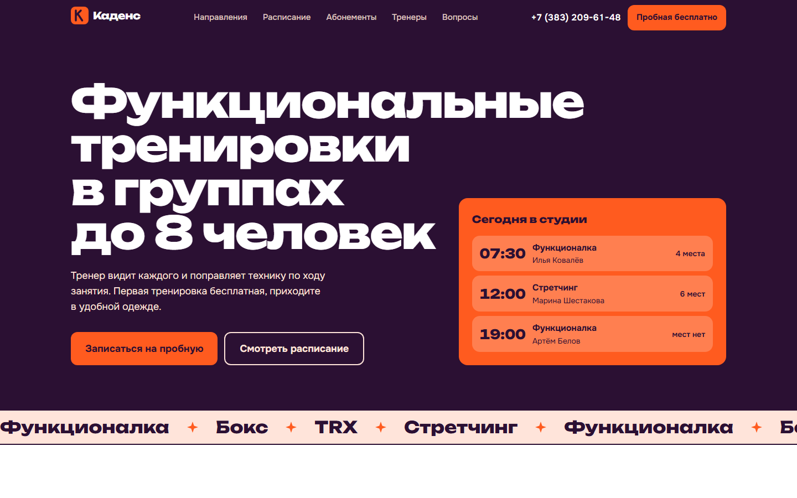
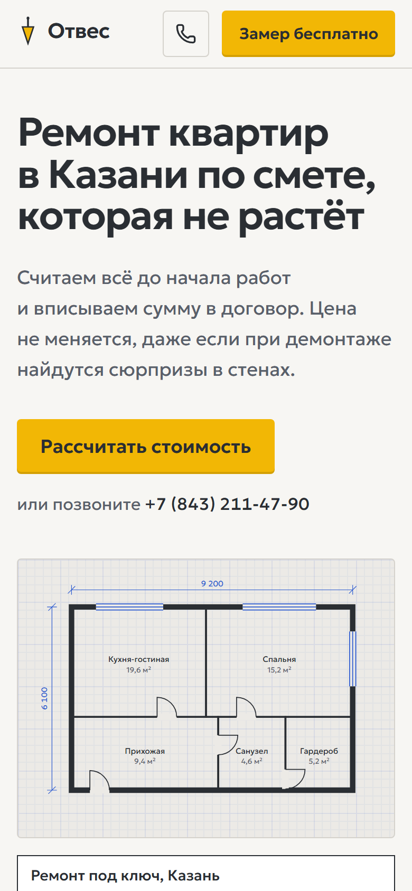
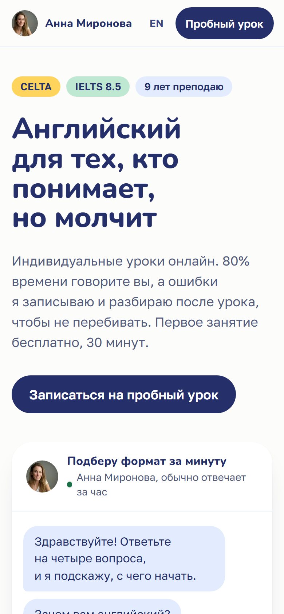
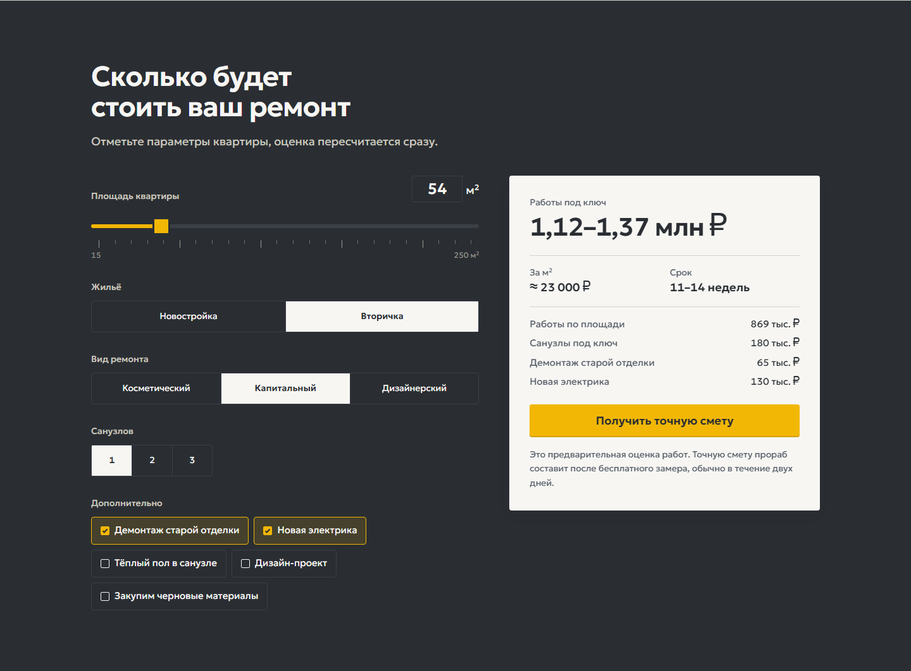
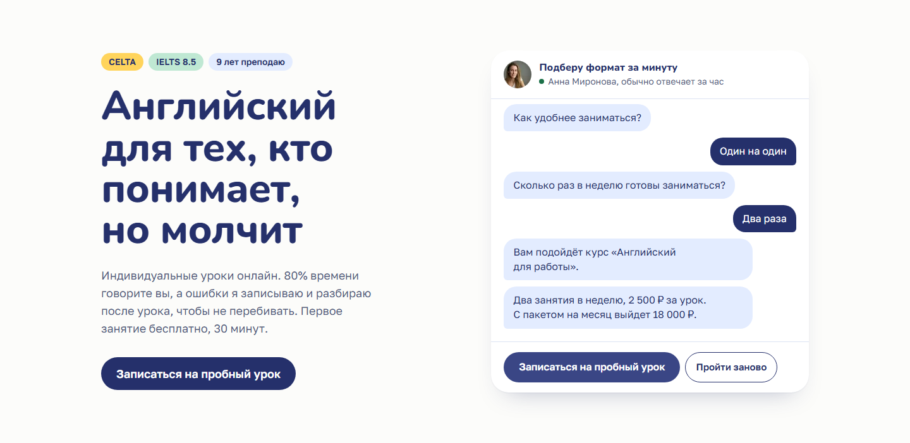
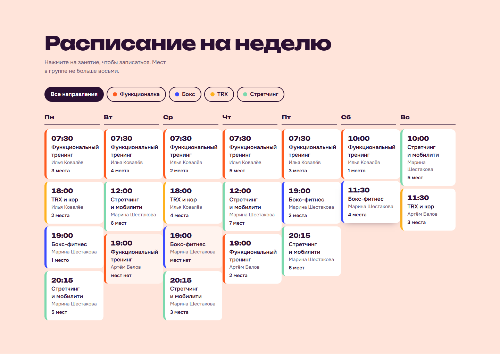

# Local Landings

Three landing pages for local businesses that turn visitors into leads. One Astro codebase, three separate designs, and a small API that sends every request to Telegram and a CRM.

| Apartment renovation | English tutor (RU + EN) | Fitness studio |
|---|---|---|
|  |  |  |
|  |  |  |

The businesses, people, prices and contacts are made up for the demo. Photos are from [Unsplash](https://unsplash.com) under the Unsplash License.

## What's inside

| Site | Business | The part that sells |
|---|---|---|
| `apps/repair` | «Отвес», apartment renovation in Kazan | Cost calculator: area, building type, scope and extras give a price range and a timeline, then attach the estimate to the request |
| `apps/tutor` | Anna Mironova, English tutor, Russian and English versions | Course picker styled as a chat with the tutor: four questions, a course and a monthly price |
| `apps/fitness` | «Каденс», functional training studio in Novosibirsk | Live "next classes" card and a weekly timetable with filters; tapping a class pre-fills the booking |

| Cost calculator | Course picker | Weekly timetable |
|---|---|---|
|  |  |  |

Every site has the blocks clients ask for in this niche: offer, services and prices, process, cases or reviews, about, FAQ, contacts and a map.

## Features

### Lead capture

- Phone mask for Russian numbers (a typed leading 8 becomes +7), international numbers on the English page.
- The same validation rules run in the browser and on the server, so error messages match.
- Spam protection without a captcha: a hidden honeypot field, a fill timer, a per-client limit (IPv6 grouped by /64) and a per-site cap. Bots get a fake "accepted" answer and nothing to tune against.
- Calculator, quiz and timetable answers travel with the lead, so the manager sees "54 m², old building, capital renovation, 1.12 to 1.37 M ₽" instead of just a phone number.

### Delivery

- Telegram bot message to a manager or a group chat.
- amoCRM: a deal with a contact in one call (`/api/v4/leads/complex`) plus a note with the answers.
- Bitrix24: `crm.lead.add` through an incoming webhook.
- A mock CRM for demos. Channels are independent: if one is down the lead still arrives, and if all are down the visitor is asked to message on Telegram instead of losing the request.

### Speed and SEO

- Lighthouse on a throttled mobile profile: Performance 96 to 100, Accessibility, Best Practices and SEO 100 on all four pages; LCP 1.5 to 1.9 s.
- Photos go through `astro:assets`: AVIF and WebP in several widths, lazy below the fold.
- Static HTML, about 8 KB of JavaScript per page (3 KB gzipped), CSS inlined.
- Self-hosted fonts through the Astro Fonts API with metric-matched fallbacks, so text does not jump when fonts load.
- The Yandex map (about 1 MB) loads only after a click.
- Meta tags, Open Graph images, JSON-LD (`HomeAndConstructionBusiness`, `EducationalOrganization`, `ExerciseGym` and `FAQPage`), sitemap, robots.txt, `hreflang` for the bilingual site.
- Russian typography: non-breaking spaces after short prepositions and between numbers and units.

### Analytics, accessibility, editing

Umami or Yandex Metrika, with `lead_submit`, `quiz_start` and `quiz_complete` goals.

For accessibility there are semantic landmarks, keyboard navigation, visible focus, live regions for errors and results, `prefers-reduced-motion` support, checked from 360 px wide.

All texts, prices and the timetable live in one YAML file per site and are validated by a schema at build time. A typo breaks the build with a readable message instead of breaking the live page. Instructions for the client: [docs/editing-content.ru.md](docs/editing-content.ru.md).

## Stack

- **Sites**: Astro 7 (static output), TypeScript strict, Tailwind CSS v4, Lucide icons
- **Leads API**: Hono on Node.js 22, zod 4, bundled with esbuild into a single file
- **Quality**: Vitest, ESLint (typescript-eslint, astro, jsx-a11y), Prettier, `astro check`, GitHub Actions
- **Runtime**: Docker, nginx for static files and the `/api` proxy

## Getting started

Node.js 22.22 or newer.

```bash
npm ci
npm run dev:api       # leads API on :8787, mock CRM, Telegram off
npm run dev:repair    # http://localhost:4322
npm run dev:tutor     # http://localhost:4321 and /en/
npm run dev:fitness   # http://localhost:4323
```

The dev servers proxy `/api` to the leads API, so forms work end to end. Leads show up in the API log as mock CRM deals.

To send real notifications, copy `services/leads-api/.env.example` to `.env` and fill in the bot token and chat id.

### Docker

```bash
cp services/leads-api/.env.example services/leads-api/.env
docker compose up -d --build
```

Sites are on ports 8081 (renovation), 8082 (tutor) and 8083 (fitness), bound to 127.0.0.1 by default.

### Checks

```bash
npm run lint        # ESLint + Prettier
npm run typecheck   # tsc and astro check in every workspace
npm test            # Vitest
npm run build       # all three sites and the API bundle
```

## Configuration

Leads API (`services/leads-api/.env`):

| Variable | Default | Purpose |
|---|---|---|
| `TELEGRAM_BOT_TOKEN`, `TELEGRAM_CHAT_ID` | empty | Bot from @BotFather and the chat that receives leads |
| `CRM_PROVIDER` | `mock` | `mock`, `amocrm` or `bitrix24` |
| `AMOCRM_SUBDOMAIN`, `AMOCRM_TOKEN`, `AMOCRM_PIPELINE_ID` | empty | Long-lived token of a private amoCRM integration |
| `BITRIX24_WEBHOOK_URL` | empty | Incoming webhook with the `crm` scope |
| `RATE_LIMIT_PER_10_MIN` | `5` | Leads per client in 10 minutes |
| `SITE_LIMIT_PER_10_MIN` | `60` | Leads per site in 10 minutes |
| `MIN_FILL_MS` | `2500` | Faster submissions are treated as bots |
| `TRUST_PROXY` | `false` | Read the client IP from `X-Forwarded-For` |

Sites (build time, see `apps/*/.env.example`): `SITE_URL`, `BASE_PATH`, `PUBLIC_UMAMI_SRC`, `PUBLIC_UMAMI_ID`, `PUBLIC_YM_ID`. The API refuses to start with a half-filled config, for example a bot token without a chat id.

## How it works

```
apps/repair, apps/tutor, apps/fitness   Astro sites, content in src/content/*.yaml
packages/leads                          lead schema and phone rules shared by browser and server
packages/ui                             lead form, SEO, JSON-LD, FAQ, map facade, analytics, typography
services/leads-api                      domain → services → infrastructure → http
deploy/                                 nginx config and the web image
```

Each site is plain static HTML with a few small scripts for the interactive parts. The pure logic (renovation estimate, quiz routing and prices, timetable) lives in `src/lib` and is unit-tested apart from the markup. The calculator, quiz and timetable never talk to the form directly: they dispatch a `lead:context` event with their answers, and any lead form on the page picks it up. A new widget only needs to send that event.

The API keeps the layers apart. `LeadService` validates input, runs the spam checks and fans the lead out to channels with `Promise.allSettled`. Telegram, amoCRM, Bitrix24 and the mock CRM all implement one `LeadChannel` interface and are wired in `container.ts` from the environment, so adding another CRM is one class and one line.

Deployment notes: [docs/deploy.md](docs/deploy.md).

## License

MIT
